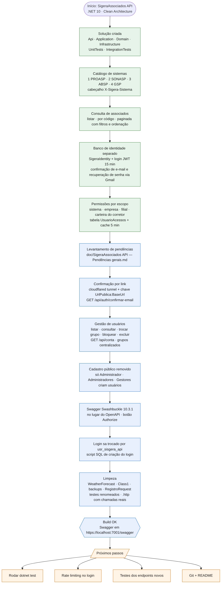
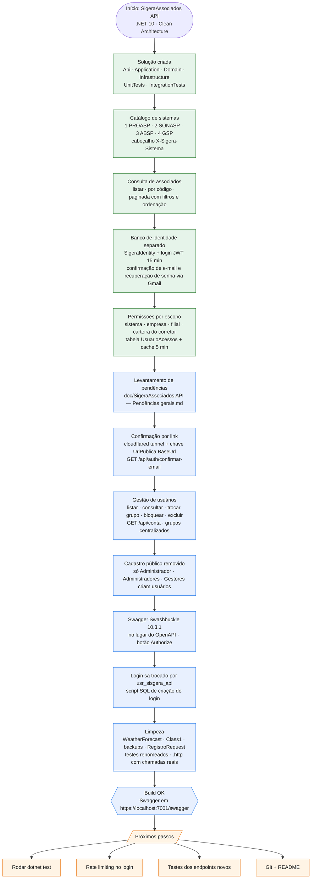
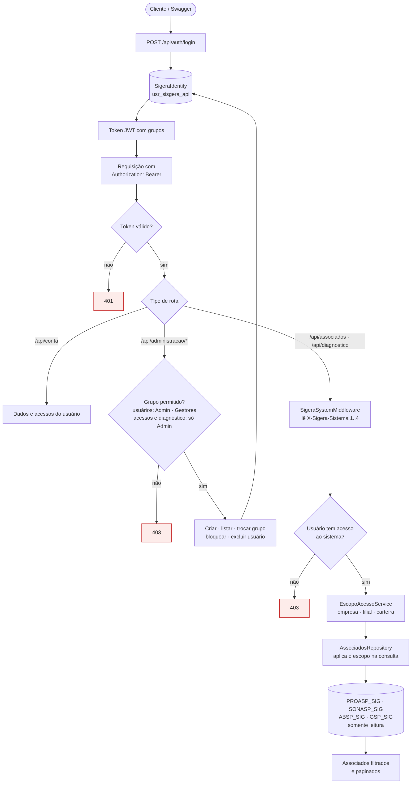
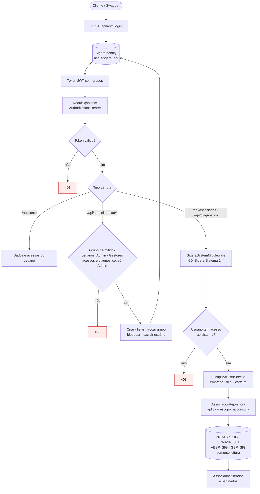
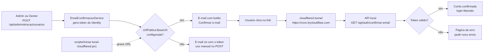
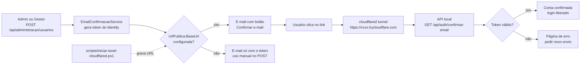

# SigeraAssociados API — Fluxogramas

Situação em 24/10/2026. Os diagramas estão em Mermaid (abrem no VS Code com extensão de Mermaid, no GitHub e no Azure DevOps) e também como imagem PNG nesta pasta.

## 1. O que foi feito até agora

Verde: base do projeto. Azul: trabalho de 24/10/2026. Laranja: próximos passos.

## 2. Como uma requisição percorre a API

Login no banco de identidade, validação do token, regras por tipo de rota e aplicação do escopo de acesso nas 4 bases.

## 3. Criação de usuário e confirmação por link

Fluxo do e-mail de confirmação com o cloudflared tunnel.

